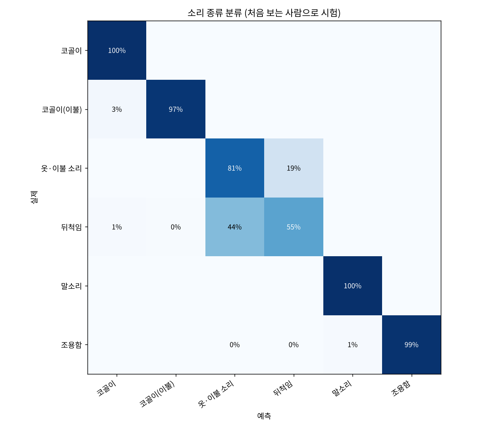
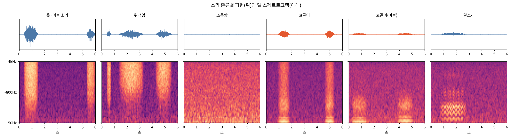
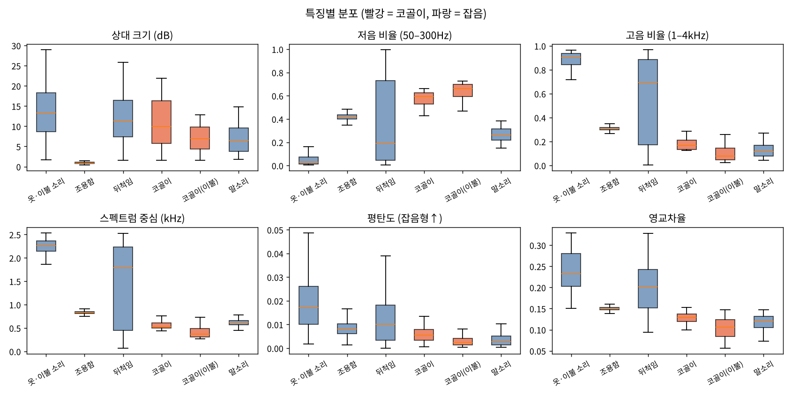
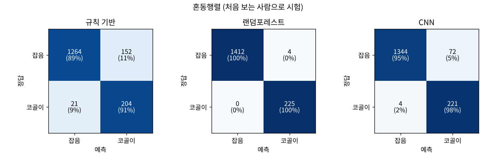
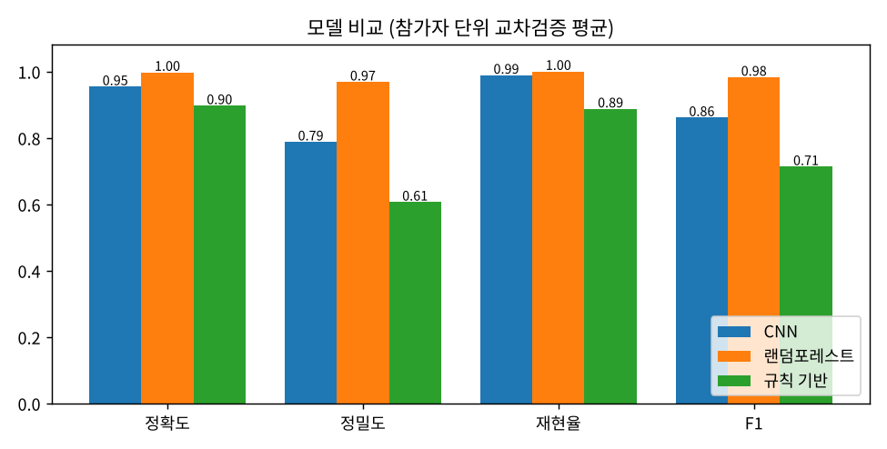
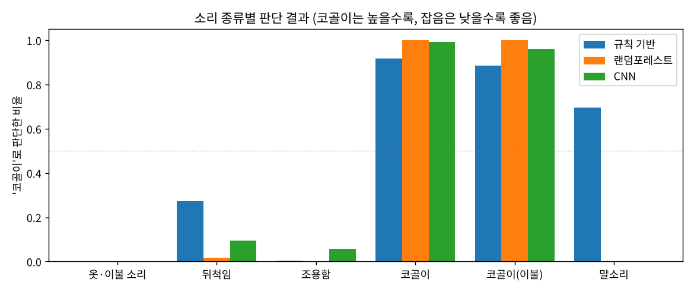

# 코골이 탐지 결과

## 데이터셋 (초)

|     |   옷·이불 소리 |   뒤척임 |   조용함 |   코골이 |   코골이(이불) |   말소리 |   합계(초) |
|:----|----------:|------:|------:|------:|----------:|------:|--------:|
| P01 |        30 |    30 |    30 |    30 |        30 |    30 |     180 |
| P02 |        30 |    30 |    30 |    30 |        30 |    30 |     180 |
| P03 |        30 |    30 |    30 |    30 |        30 |    30 |     180 |
| P04 |        30 |    30 |    30 |    30 |        30 |    30 |     180 |
| P05 |        30 |    30 |    30 |    30 |        30 |    30 |     180 |
| P06 |        30 |    30 |    30 |    30 |        30 |    30 |     180 |

- 1초 창 1641개, 증강 포함 4968개, 코골이 비율 14%

## 모델 비교 (참가자 단위 교차검증)

| 모델     | 정확도           |   정밀도 |   재현율 | F1            |
|:-------|:--------------|------:|------:|:--------------|
| CNN    | 0.954 ± 0.055 | 0.788 | 0.989 | 0.861 ± 0.142 |
| 랜덤포레스트 | 0.997 ± 0.006 | 0.968 | 1     | 0.982 ± 0.043 |
| 규칙 기반  | 0.897 ± 0.052 | 0.606 | 0.887 | 0.713 ± 0.056 |

## 개인 적응

| 모델     |   일반 F1 |   개인적응 F1 |
|:-------|--------:|----------:|
| 랜덤포레스트 |   0.974 |     0.986 |

## 소리 종류별 '코골이' 판단 비율

|         |   규칙 기반 |   랜덤포레스트 |   CNN |
|:--------|--------:|---------:|------:|
| 옷·이불 소리 |    0    |     0    |  0    |
| 뒤척임     |    0.27 |     0.02 |  0.09 |
| 조용함     |    0    |     0    |  0.06 |
| 코골이     |    0.92 |     1    |  0.99 |
| 코골이(이불) |    0.88 |     1    |  0.96 |
| 말소리     |    0.69 |     0    |  0    |

## 소리 종류 분류 (6종)

전체 정확도 0.901

|         |   맞힌 비율 |
|:--------|--------:|
| 코골이     |   1     |
| 코골이(이불) |   0.974 |
| 옷·이불 소리 |   0.812 |
| 뒤척임     |   0.547 |
| 말소리     |   1     |
| 조용함     |   0.987 |

