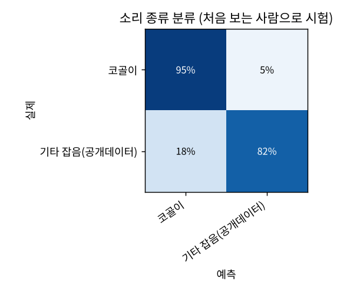
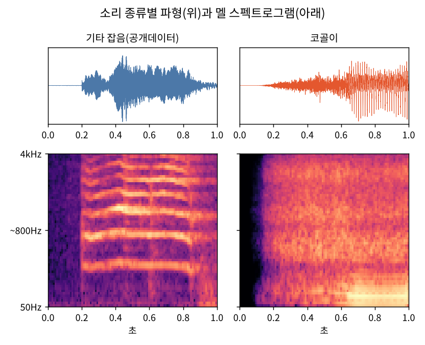
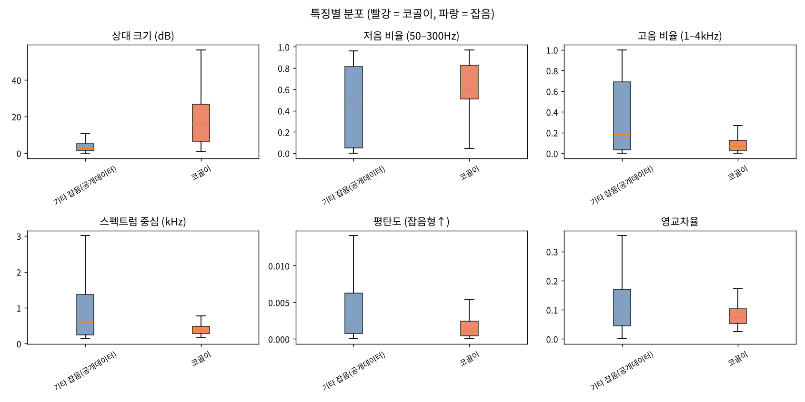
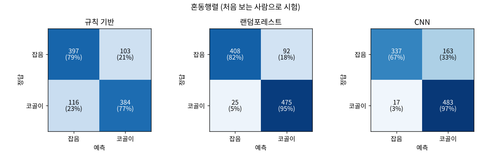
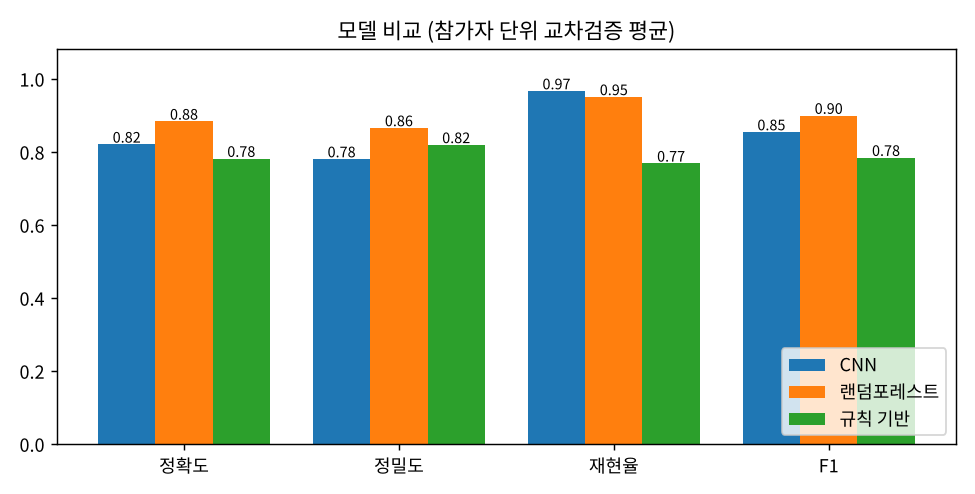
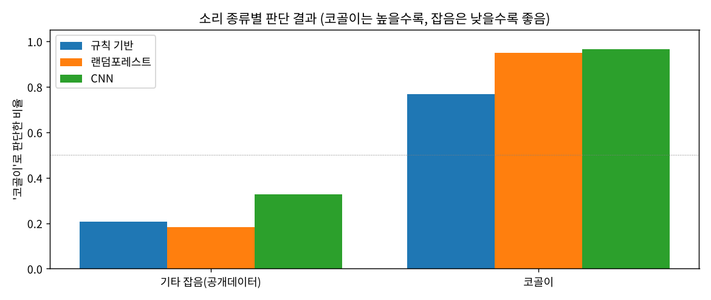

# 코골이 탐지 결과

## 데이터셋 (초)

|     |   기타 잡음(공개데이터) |   코골이 |   합계(초) |
|:----|---------------:|------:|--------:|
| KG1 |            100 |   100 |     200 |
| KG2 |            100 |   100 |     200 |
| KG3 |            100 |   100 |     200 |
| KG4 |            100 |   100 |     200 |
| KG5 |            100 |   100 |     200 |

- 1초 창 1000개, 증강 포함 3000개, 코골이 비율 50%

## 모델 비교 (참가자 단위 교차검증)

| 모델     | 정확도           |   정밀도 |   재현율 | F1            |
|:-------|:--------------|------:|------:|:--------------|
| CNN    | 0.820 ± 0.147 | 0.78  | 0.966 | 0.854 ± 0.110 |
| 랜덤포레스트 | 0.883 ± 0.120 | 0.865 | 0.95  | 0.899 ± 0.092 |
| 규칙 기반  | 0.781 ± 0.114 | 0.819 | 0.768 | 0.784 ± 0.092 |

## 개인 적응

| 모델     |   일반 F1 |   개인적응 F1 |
|:-------|--------:|----------:|
| 랜덤포레스트 |   0.899 |     0.943 |

## 소리 종류별 '코골이' 판단 비율

|              |   규칙 기반 |   랜덤포레스트 |   CNN |
|:-------------|--------:|---------:|------:|
| 기타 잡음(공개데이터) |    0.21 |     0.18 |  0.33 |
| 코골이          |    0.77 |     0.95 |  0.97 |

## 소리 종류 분류 (6종)

전체 정확도 0.883

|              |   맞힌 비율 |
|:-------------|--------:|
| 코골이          |   0.95  |
| 기타 잡음(공개데이터) |   0.816 |

